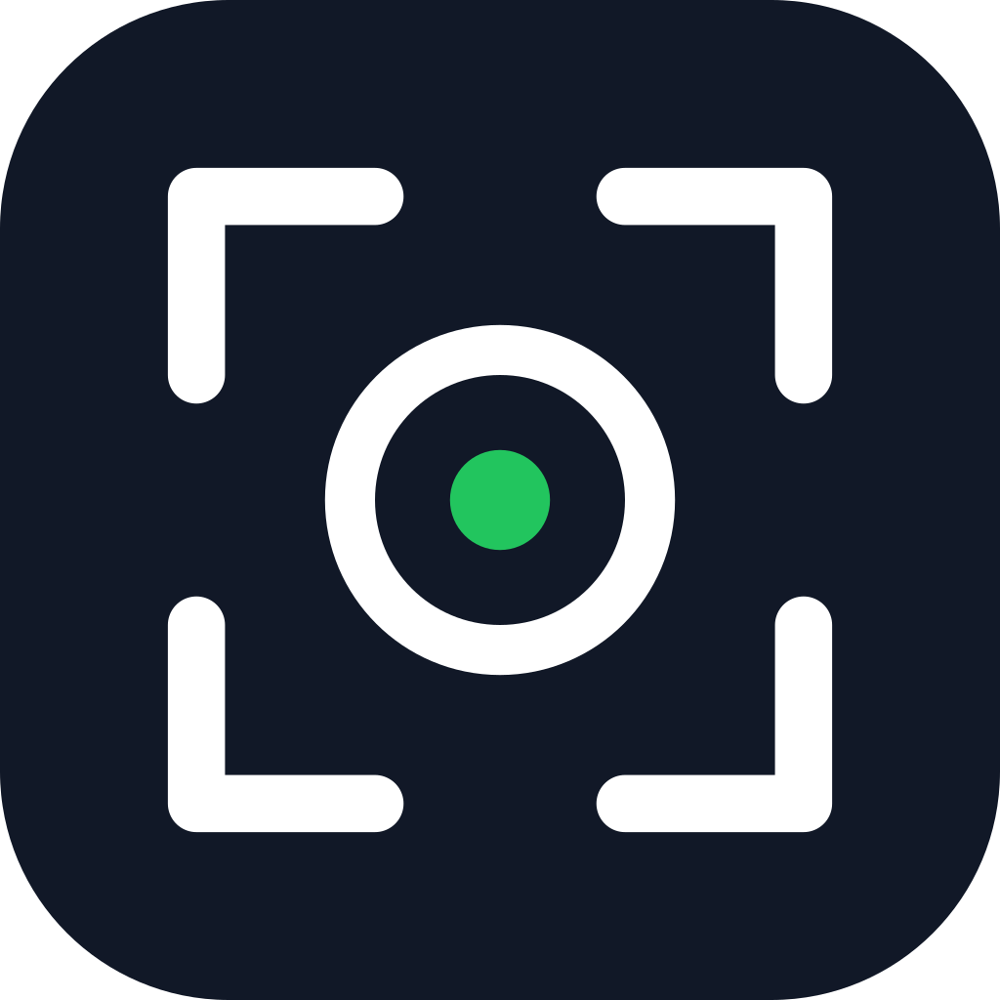
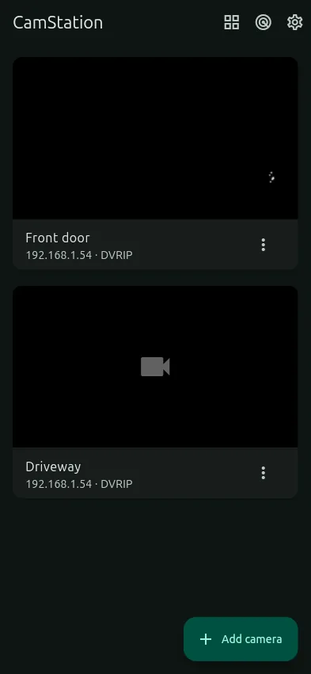
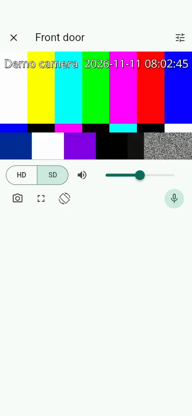
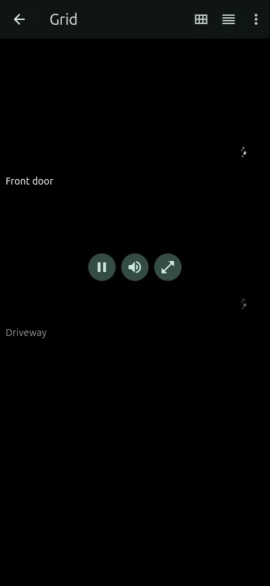
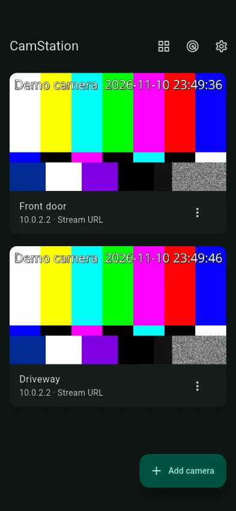

  

<h1 align="center">CamStation</h1>

  A fast, private, open-source app for watching and managing your IP cameras, 
  on <b>Android</b>, <b>Windows</b> and <b>Linux</b>, with sound and two-way talk.

  
  
  
  

## Features

- **Finds your cameras.** It scans your network (ONVIF and DVRIP), including cameras on other
  subnets. Or enter an IP address: *Test* works out the best way to connect for you.
- **Live view with sound.** It starts in about a second, with HD/SD, volume, snapshots, full
  screen, pinch to zoom, and swipe to the next camera.
- **Push-to-talk.** Hold the button to speak through the camera's speaker.
- **Grid.** Watch several cameras at once. Tiles fit the screen automatically, or pick 1–4
  columns. Rearrange them, hide some, pause any tile, and pick which one you hear.
- **Opens the way you left it.** Each camera remembers its stream, sound, volume, orientation
  and full screen, or you can set fixed defaults per camera.
- **Camera settings.** Video quality, frame rate, bitrate, audio on/off, image, clock, password
  and restart, over DVRIP or ONVIF. Only what the camera supports is shown.
- **Private.** Video stays on your network and your device. Passwords live in the system's
  secure storage. No account, no cloud, no tracking.
- **Light and dark themes** with a choice of accent colours.
- **Keeps the screen on** while you watch, always, or never: your choice.

## Supported cameras

| Connection | Typical cameras | Two-way talk |
|---|---|---|
| ONVIF | Most IP cameras and NVRs (Profile S/T) | ✓ when offered |
| DVRIP | Many budget cameras and DVRs (port 34567) | ✓ |
| RTSP | Anything with an `rtsp://` / `rtsps://` stream | ✓ when offered |
| Stream URL | RTMP, HTTP MJPEG/MP4/HLS, Hikvision ISAPI, TP-Link Tapo/Kasa/VIGI | depends |

Video codecs: H.264 and H.265. Audio: G.711, Opus and AAC.

## Download

Get the latest build from [Releases](https://github.com/MatthewReed303/camstation/releases):

| Platform | File |
|---|---|
| Android 8.0+ | `CamStation-<version>.apk` |
| Windows 10/11 (x64) | `CamStation-<version>-setup.exe` |
| Linux (x64) | `CamStation-<version>-x86_64.AppImage` |

New to the app? See the [user guide](docs/USER_GUIDE.md).
Building from source? See [development](docs/DEVELOPMENT.md).

## Credits

- [go2rtc](https://github.com/AlexxIT/go2rtc) by Alex X (MIT): the media and camera protocol
  engine. CamStation uses
  [a build with small Android and DVRIP fixes](https://github.com/MatthewReed303/go2rtc/tree/camstation).
- [Flutter](https://flutter.dev) and [flutter_webrtc](https://pub.dev/packages/flutter_webrtc) (MIT).
- [fvp](https://pub.dev/packages/fvp) (BSD-3) with libmdk (freeware) for the fallback player.
- [Riverpod](https://riverpod.dev), [go_router](https://pub.dev/packages/go_router),
  [flutter_secure_storage](https://pub.dev/packages/flutter_secure_storage) and
  [wakelock_plus](https://pub.dev/packages/wakelock_plus).
- DVRIP protocol notes from [OpenIPC/python-dvr](https://github.com/OpenIPC/python-dvr).

## Licence

MIT. See [LICENSE](LICENSE).
