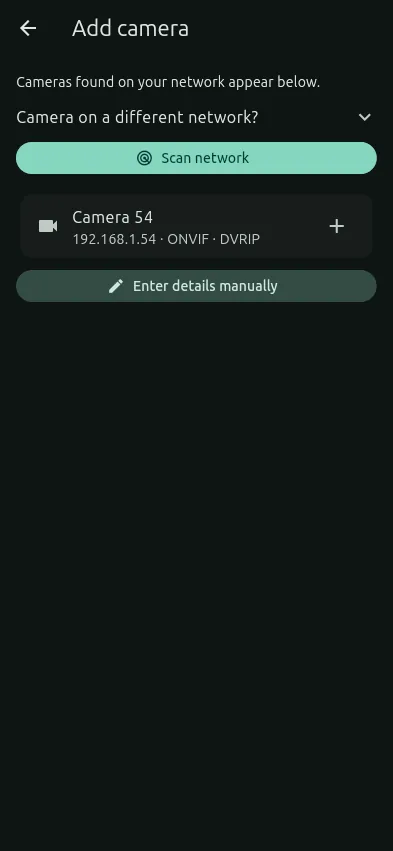
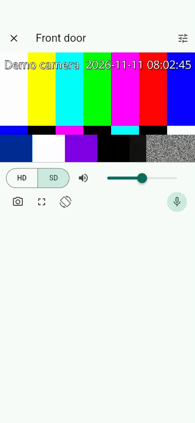
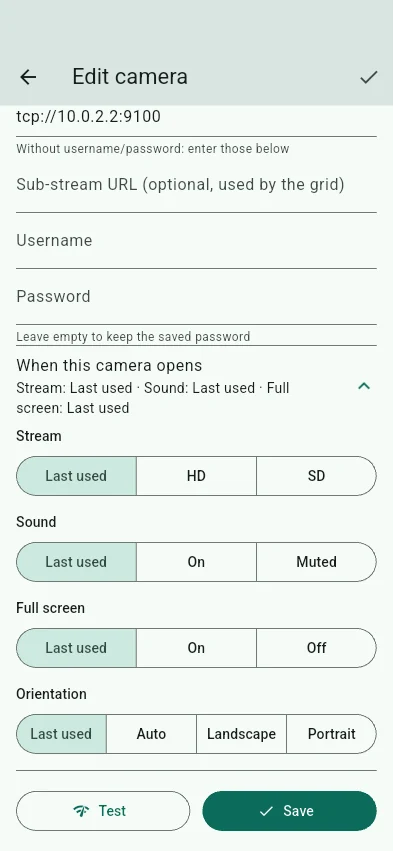
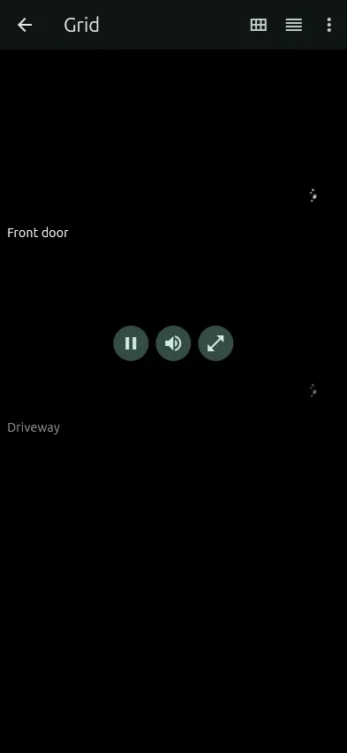
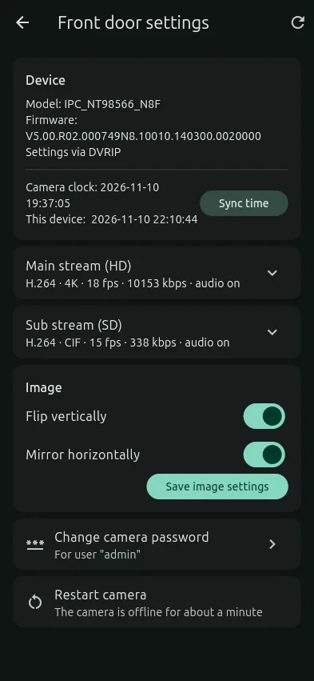

# CamStation user guide

## Adding a camera

1. Tap **Add camera**. CamStation scans your network straight away.
2. Tap your camera in the list. If it isn't there:
   - **Camera on a different network?** Enter its network (e.g. `192.168.1.0/24`) or address,
     then **Scan network** again.
   - Or tap **Enter details manually** and type the camera's IP address.
3. Enter the username and password (leave the password empty if the camera has none).
4. Tap **Test**. CamStation tries each way of connecting and shows what each one gives you:
   video, sound and two-way talk. The best one is selected.
5. Give the camera a name and tap **Save**.

Networks of cameras you have added are always included in later scans.

 

## Watching

- Tap a camera to open it. **✕** takes you back to the list.
- **HD / SD:** the full-quality stream, or a lighter one (good on mobile data or older phones).
- **Volume:** mute, or set the volume.
- **Snapshot:** saves a picture. On Android it goes to the app's folder; on desktop, to
  Downloads/CamStation.
- **Full screen:** double-tap the video or use the full-screen button. Tap the video to show
  or hide the controls.
- **Rotate** (phones): auto-rotate, landscape or portrait.
- **Pinch** to zoom in. Tap **Reset zoom** to go back.
- **Swipe** left or right to move to the next camera.
- **Hold to talk:** press and hold to speak through the camera's speaker. This needs the
  camera to support two-way audio; the first time, Android asks for microphone access.

 

## When a camera opens

Each camera remembers how you last watched it: HD/SD, sound, volume, orientation and full
screen. To fix them instead, open the camera's **⋮ → Edit → When this camera opens**:

- **Stream:** Last used, HD or SD.
- **Sound:** Last used, On or Muted.
- **Full screen:** Last used, On or Off.
- **Orientation:** Last used, Auto, Landscape or Portrait.

 

## Grid

- Tap the grid icon on the camera list.
- **Layout:** choose 1–4 columns. Only cameras on screen play, to save data and battery.
- **Tap a tile** for its controls: pause, sound and open. A paused tile shows its last image.
- **Double-tap** a tile to open it.
- **Arrange:** drag cameras into order and switch off the ones you don't want in the grid.
- **⋮ → Pause all / Play all.**

 

## Camera settings

Open a camera and tap the settings icon, or use **⋮ → Camera settings** on the list.
What you can change depends on the camera:

- **Clock:** set the camera's time from your device.
- **Video, per stream:** codec, resolution, frame rate, bitrate, CBR/VBR, keyframe interval,
  and audio on/off. A shorter keyframe interval makes video start faster.
- **Image:** flip/mirror, or brightness, contrast, saturation and sharpness.
- **Pan / tilt / zoom:** hold a direction to move.
- **Password:** changes it on the camera, and in CamStation too.
- **Restart camera.**

 

## App settings

- **Theme:** System, Light or Dark, and an accent colour.
- **Default stream:** what cameras open with before you have watched them.
- **Player:** Auto picks the best player for each camera. Choose WebRTC or RTSP only if
  asked to while troubleshooting.
- **Show stream details:** shows the player and codecs on the video.

## Troubleshooting

| Problem | Try |
|---|---|
| Camera not found when scanning | Enter its network under *Camera on a different network?*, or add it by IP address |
| "Wrong username or password" | Check the camera's login. Some cameras lock you out for a few minutes after several wrong tries |
| Video but no sound | In **Camera settings → Video**, turn **Audio** on for the stream |
| Slow to start | Lower the keyframe interval in Camera settings (1–2 s) |
| Talk says the camera is busy | Close other apps or devices that are talking to the camera, then try again |
| Anything else | **Settings → Media engine and diagnostics → Copy**, then include the log when you report the problem |
